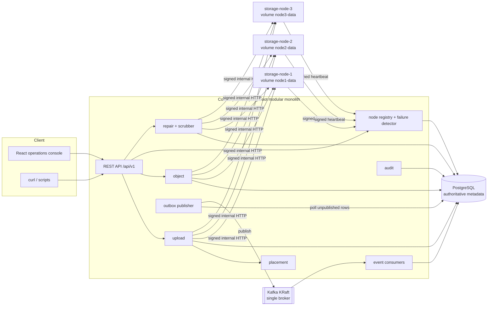
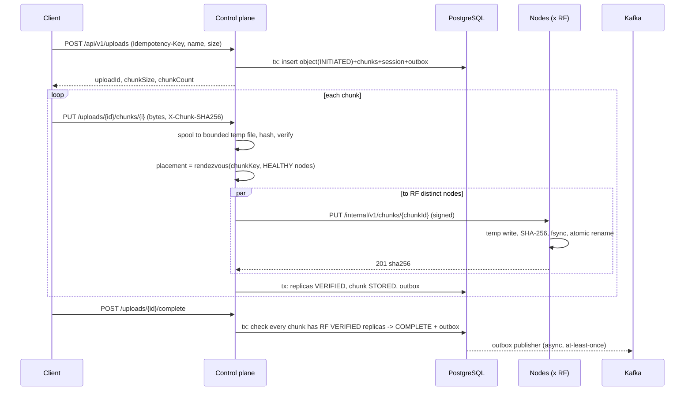

# ByteVault architecture

ByteVault is a self-healing distributed object store built as an engineering
demonstration. It runs on one machine via Docker Compose. It stores objects as
SHA-256-checksummed chunks spread across three independent storage-node
processes. PostgreSQL holds the authoritative metadata, and Kafka carries
domain events.

> Status: this document describes the **target** design. What is actually
> implemented today is tracked in [implementation-status.md](implementation-status.md).

## Components

| Component | Technology | Responsibility |
|---|---|---|
| Control plane (`backend/`) | Java 21, Spring Boot 3.5, Spring Kafka, Flyway | Public API, upload orchestration, placement, metadata, node lifecycle, repair, outbox, consumers, audit |
| Storage node (`storage-node/`) | Java 21, Spring Boot 3.5 (web only) | Durable chunk bytes on its own volume; checksum verification; heartbeat |
| Metadata | PostgreSQL 16 | **Source of truth** for objects, chunks, replicas, nodes, sessions, repair jobs, outbox, audit |
| Event transport | Apache Kafka 3.9, KRaft, 1 broker | Event history and async work distribution. **Not** a source of truth |
| Frontend (`frontend/`) | React 18, TypeScript, Vite | Operations console; every live value comes from the API |
| Monitoring (optional profile) | Prometheus, Grafana | Scrapes `/actuator/prometheus` |

## Control-plane module boundaries

The control plane is a single deployable split into packages under
`dev.bytevault.controlplane`. Each package exposes a small service API, and
other packages do not reach into its repositories.

| Package | Owns tables | Depends on |
|---|---|---|
| `upload` | `upload_sessions` | `object`, `placement`, `nodeclient`, `outbox` |
| `object` | `objects`, `chunks`, `chunk_replicas` | `outbox` |
| `placement` | - (pure function) | - |
| `node` | `storage_nodes` | `outbox`, `audit` |
| `nodeclient` | - (signed HTTP client to nodes) | - |
| `repair` | `repair_jobs` | `object`, `node`, `placement`, `nodeclient`, `outbox` |
| `outbox` | `outbox_events`, `processed_events` | - |
| `audit` | `audit_events` | - |
| `common` / `web` | - | correlation IDs, error envelope, config |

## Trust boundaries

1. **Client to control plane:** an authenticated public API (USER/ADMIN) on
   `127.0.0.1:8090`. Every client input is untrusted, and filenames are only
   display metadata.
2. **Control plane to storage node:** an internal HTTP API on the Compose
   network. Requests are HMAC-signed with a per-node secret and a timestamp.
   See [storage-node-protocol.md](storage-node-protocol.md).
3. **Storage node to control plane:** heartbeats, signed with the same per-node
   secret.
4. **Control plane to PostgreSQL/Kafka:** credentials come from the environment
   and are never committed.

## Upload data flow (target)

## Key invariants

These must never be violated:

- PostgreSQL is authoritative. Kafka is transport. Bytes live only on storage
  nodes.
- A chunk's replicas sit on distinct `storage_nodes.id` values, enforced by
  the `UNIQUE(chunk_id, node_id)` constraint.
- `COMPLETE` means every chunk has `replication_factor` VERIFIED replicas. The
  factor is never lowered silently.
- Bytes are verified on write, on read, and by the periodic scrubber.
- A repair copies from a verified source and verifies the target before it
  commits metadata. It never retires the source first.
- State changes and outbox rows commit in one transaction. Consumers are
  idempotent, and delivery is at-least-once.
- No database transaction stays open across a network transfer.

## Local topology

See [ADR-0008](adr/0008-local-topology.md). Host ports are chosen so they
don't collide with services already running on the dev machine:

| Service | Host port | In-network address |
|---|---|---|
| Control plane | 127.0.0.1:8090 | backend:8090 |
| PostgreSQL | 127.0.0.1:55432 | postgres:5432 |
| Kafka (external listener) | 127.0.0.1:9092 | kafka:29092 |
| storage-node-1/2/3 | 127.0.0.1:9101-9103 | node-N:9100 |
| Frontend dev server | 127.0.0.1:5173 | - |
| Prometheus / Grafana (profile `monitoring`) | 9090 / 3001 | - |

## Honest limitations

All nodes share one host, one disk and one Docker VM. The demo shows behaviour
when a process or node fails, not independent physical failure domains. A
single Kafka broker is not highly available. See
[security-threat-model.md](security-threat-model.md) and the README's
limitations section.
