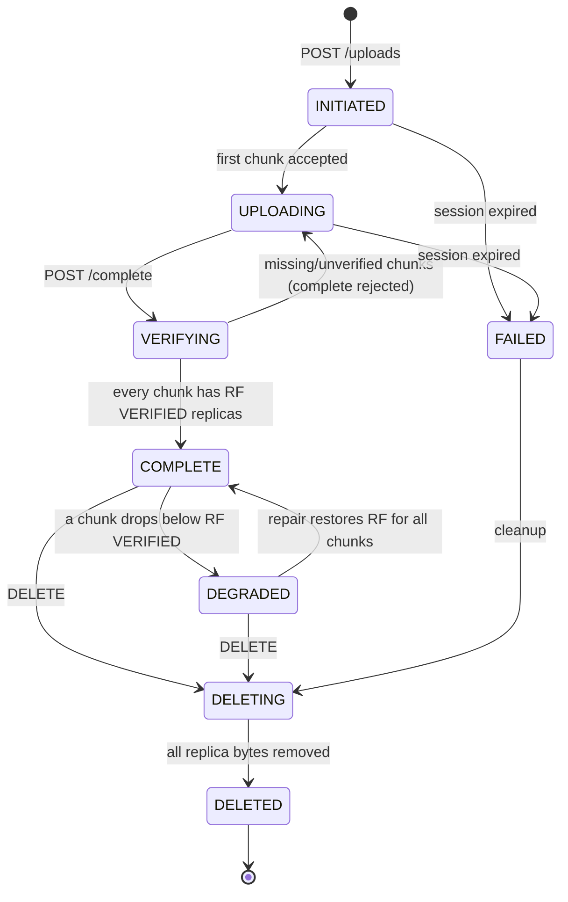
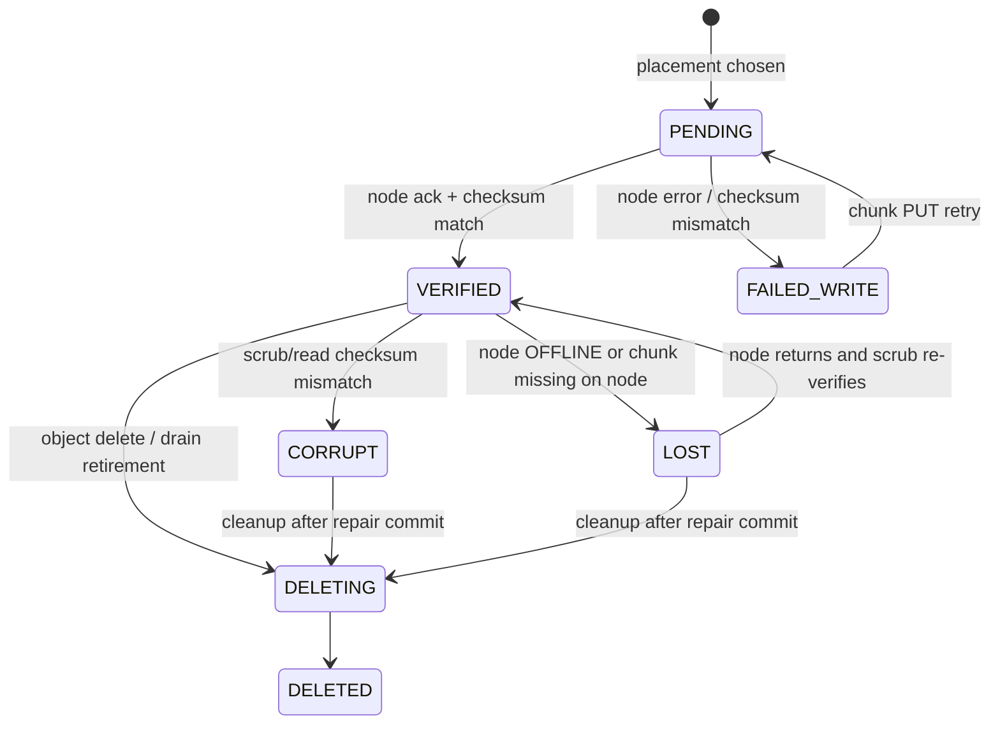
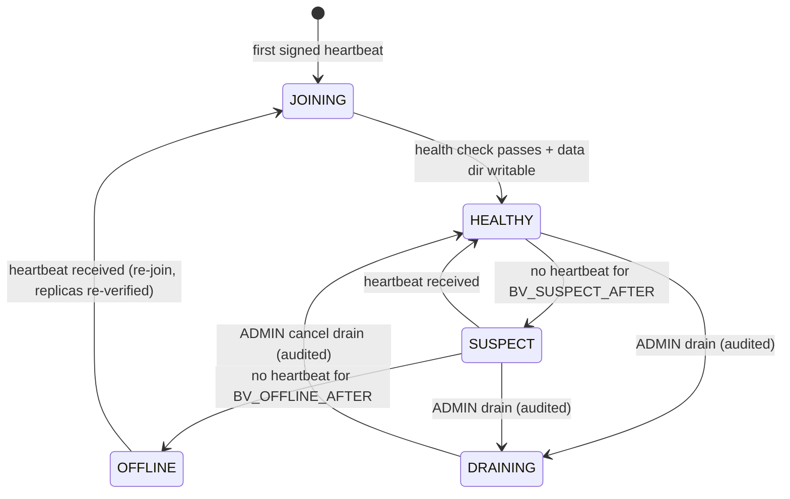

# State machines

Service methods enforce every transition: they check the current state and
the `version` column (optimistic locking) before writing. Any transition not
listed here is rejected with `409 INVALID_STATE_TRANSITION`. Each transition
writes an outbox event in the same transaction, and transitions of nodes and
repair jobs also write an audit row.

The database stores states as `VARCHAR` with a `CHECK` constraint. See
`backend/src/main/resources/db/migration/V1__baseline_schema.sql`.

## Object

| From | To | Trigger | Guard |
|---|---|---|---|
| INITIATED | UPLOADING | first chunk PUT succeeds | session ACTIVE |
| UPLOADING | VERIFYING | complete request | session ACTIVE |
| VERIFYING | COMPLETE | completion check | every chunk STORED with RF VERIFIED replicas on distinct nodes |
| VERIFYING | UPLOADING | completion check fails | response lists the missing chunk indexes |
| INITIATED/UPLOADING | FAILED | session expiry sweeper | `expires_at < now()` |
| COMPLETE | DEGRADED | replica marked LOST/CORRUPT | VERIFIED count < RF for at least one chunk |
| DEGRADED | COMPLETE | repair committed | VERIFIED count = RF for every chunk |
| COMPLETE/DEGRADED/FAILED | DELETING | DELETE (idempotent) | owner or ADMIN |
| DELETING | DELETED | cleanup worker | every replica DELETED on its node |

Only `COMPLETE` and `DEGRADED` objects can be downloaded. `DEGRADED` needs at
least one VERIFIED replica per chunk.

## Chunk

`PENDING -> STORED` happens once RF replicas are VERIFIED. `STORED -> UNDER_REPLICATED`
happens when the VERIFIED count drops below RF, and `UNDER_REPLICATED -> STORED`
when a repair commits. `-> DELETING -> DELETED` follows the object.

## Replica

`UNIQUE(chunk_id, node_id)` means a node holds at most one replica row per
chunk. A retry reuses that row and never creates a duplicate.

## Storage node

- **SUSPECT:** the node isn't used for new placements, but its replicas are
  *not* marked LOST, because a missed heartbeat is only a suspicion.
- **OFFLINE:** its replicas are marked LOST, and under-replication repair
  starts.
- **DRAINING:** the node isn't used for new placements, and its replicas are
  copied elsewhere. It may be removed only once no VERIFIED replica relies on
  it alone, or with an audited degraded override.

## Upload session

`ACTIVE -> COMPLETED`, `ACTIVE -> EXPIRED`, `ACTIVE -> ABORTED`.
`(owner_id, idempotency_key)` is unique. A repeated `POST /uploads` with the
same key and the same parameters returns the existing session. The same key
with different parameters returns `422 IDEMPOTENCY_KEY_REUSED`.

## Repair job

```mermaid
stateDiagram-v2
    [*] --> PENDING
    PENDING --> CLAIMED: CAS + lease
    CLAIMED --> COPYING
    COPYING --> VERIFYING
    VERIFYING --> COMMITTED: target checksum matches; tx inserts VERIFIED replica
    CLAIMED --> FAILED
    COPYING --> FAILED
    VERIFYING --> FAILED
    FAILED --> PENDING: attempts < max (backoff)
    FAILED --> ABANDONED: attempts exhausted
    CLAIMED --> PENDING: lease expired (takeover)
    COPYING --> PENDING: lease expired
    VERIFYING --> PENDING: lease expired
```

